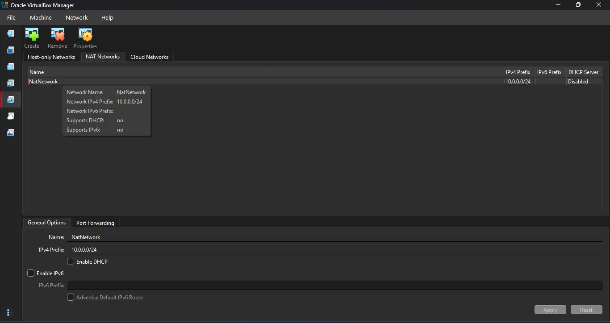
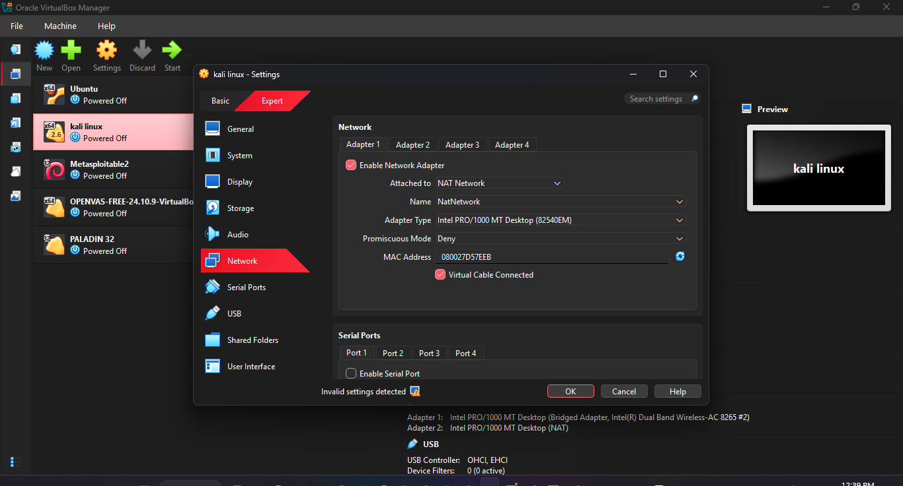
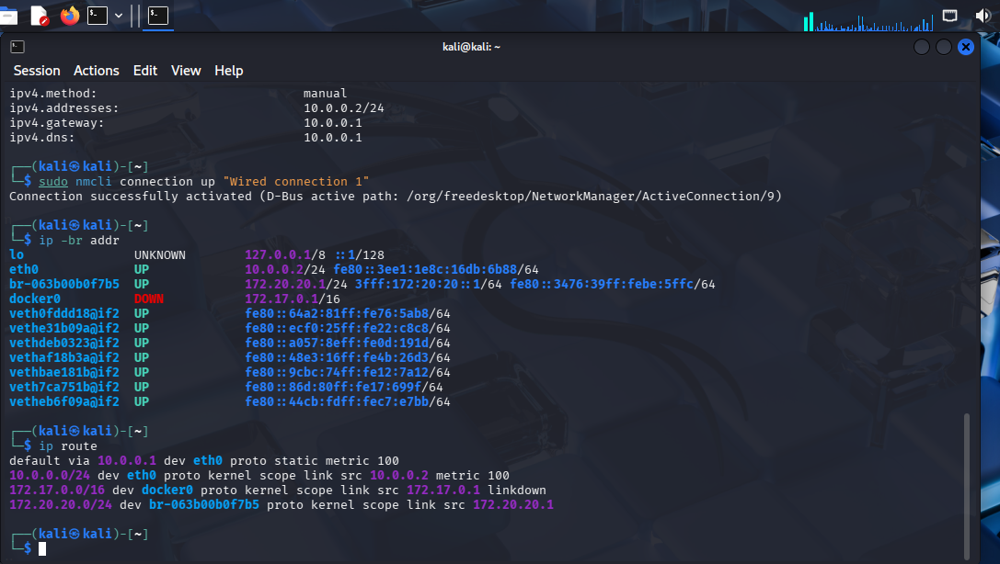
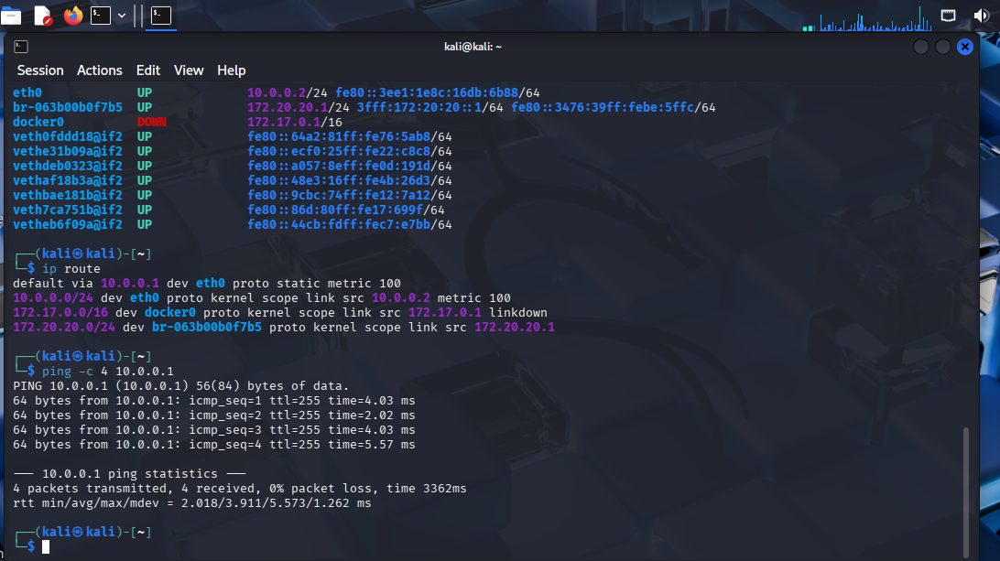
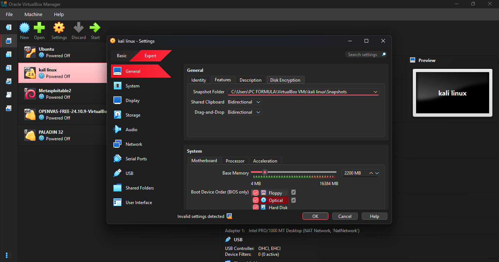
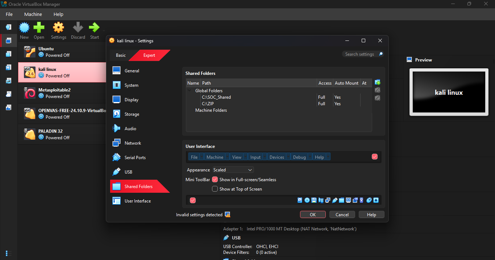
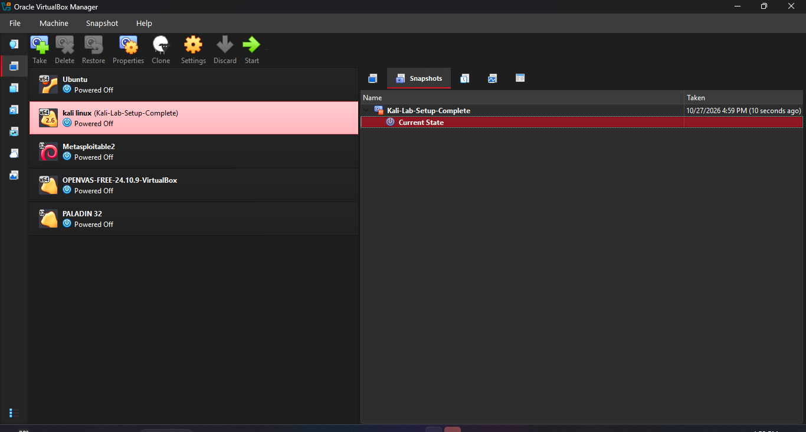

# VirtualBox Cybersecurity Lab Setup

## Overview

This project involved building a virtual lab for cybersecurity practice using VirtualBox and Kali Linux. The goal was to configure a dedicated testing machine with a static IP address, internet connectivity, host integration, and a recovery point for future exercises.

## Lab Environment

| Setting | Value |
|---|---|
| Virtualization platform | Oracle VirtualBox |
| Virtual machine | Kali Linux |
| Network type | NAT Network |
| Network name | `NatNetwork` |
| Network subnet | `10.0.0.0/24` |
| Kali IPv4 address | `10.0.0.2/24` |
| Default gateway | `10.0.0.1` |
| DNS servers | `8.8.8.8`, `1.1.1.1` |

### Virtual Network Configuration

I created a custom NAT Network in VirtualBox and connected Kali Linux to it. DHCP was disabled, and the VM was configured with a static IPv4 address.





### Kali Network Configuration

The network settings were applied through NetworkManager. I verified the interface address and default route using:

```bash
ip -br addr
ip route
```

The `eth0` interface showed `10.0.0.2/24`, with the default gateway set to `10.0.0.1`.



## Connectivity Verification

I tested the connection to the virtual gateway, checked internet reachability by IP address, and tested DNS resolution.

| Check | Command | Result |
|---|---|---|
| Gateway connectivity | `ping -c 4 10.0.0.1` | 4 replies received; 0% packet loss |
| Internet connectivity | `ping -c 4 8.8.8.8` | Successful |
| DNS resolution | `ping -c 4 google.com` | Successful after DNS configuration |




### DNS Troubleshooting

Initially, Kali could reach the gateway, but domain names could not be resolved. I updated the DNS servers in the NetworkManager profile and reactivated the connection.

```bash
sudo nmcli connection modify "Wired connection 1" ipv4.dns "8.8.8.8 1.1.1.1"
sudo nmcli connection up "Wired connection 1"
```

After the change, the domain-name test succeeded. This helped me distinguish a DNS resolution problem from basic IP connectivity.

## Virtual Machine Integration

I enabled bidirectional clipboard sharing and drag-and-drop in the Kali VM's VirtualBox settings.



I also configured the host's Downloads folder as a shared folder. I verified that it was accessible inside Kali at `/media/sf_downloads`.



## Recovery Snapshot

After completing the configuration, I created a VirtualBox snapshot named `Kali-Lab-Setup-Complete`. This preserves a baseline that can be used to return to the configured state if a future lab exercise changes the VM.



## Key Takeaways

- Configured a custom VirtualBox NAT Network and static IPv4 addressing.
- Used gateway, IP-based, and DNS tests to troubleshoot connectivity.
- Integrated a host folder with Kali Linux.
- Enabled clipboard and drag-and-drop functionality.
- Created a VM snapshot for recovery before future practical exercises.

## Responsible Use

This environment is intended for cybersecurity education and authorized testing. Any future assessment of other systems will be performed only with appropriate permission.

## Tools and References

- [Oracle VirtualBox](https://www.virtualbox.org/wiki/Downloads)
- [Kali Linux](https://www.kali.org/get-kali/)

## Project Details

- **Program:** Networkwalks Cybersecurity
- **Task:** WK1-PM1
- **Project:** VirtualBox and Kali Linux Lab Setup
- **Author:** Chinemerem Ndubuisi
